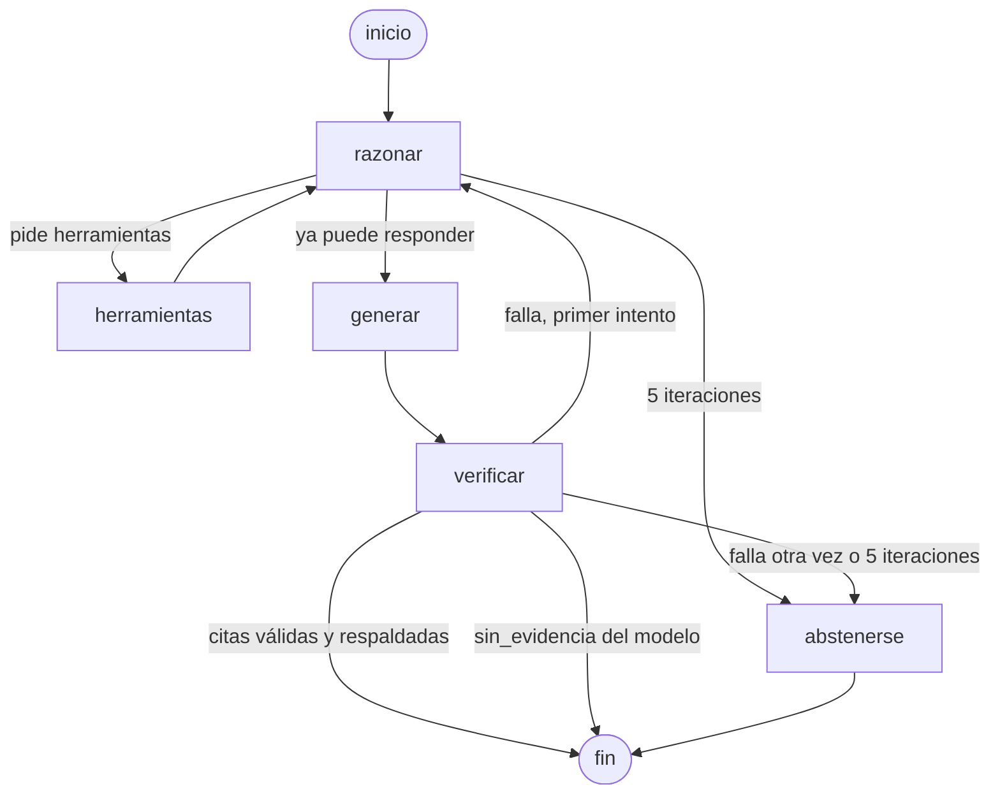

# Decisiones técnicas

Registro de por qué se eligió cada pieza. Una entrada por decisión no obvia.

## Fase 0. Preparación

### uv como gestor de dependencias
Resuelve e instala mucho más rápido que pip/poetry, genera `uv.lock` reproducible y además
instala la versión de Python indicada en `.python-version` (3.12) sin depender del Python del sistema.

### Layout `src/articulia/` (paquete instalable)
`uv init --package` crea un paquete instalable en modo editable. Así las pruebas, la API, la
evaluación y el servidor MCP importan `articulia` igual, y se evita que los tests pasen por
importar archivos sueltos desde la raíz del repo.

### Imagen `pgvector/pgvector:pg16`
Es PostgreSQL 16 oficial con la extensión `vector` ya compilada. La extensión se habilita en
`src/articulia/db/init/001_extensions.sql`, montado en `/docker-entrypoint-initdb.d`, que
Postgres ejecuta solo la primera vez que crea el volumen. Una sola base sirve para la búsqueda
vectorial (pgvector) y la de texto completo (`tsvector` en español), sin un vector store aparte.

### Configuración con pydantic-settings
`config.py` define un único `Settings` validado que lee variables de entorno y `.env`.
`get_settings()` va cacheado para no releer el archivo en cada llamada; en pruebas se limpia
la caché con `get_settings.cache_clear()`.

### Prueba de base de datos que se salta sin Docker
`tests/test_db.py` se marca como `skip` si no puede conectarse, para que `pytest` no falle en
máquinas sin la base levantada. En CI (Fase 7) la base estará disponible y la prueba sí correrá.

## Fase 1. Corpus e ingesta

### PyMuPDF directo, sin loaders de LangChain
Los PDFs de LeyesBiblio son texto nativo (no escaneado), y `pymupdf` da el texto por página, que
es justo lo que hace falta para quitar el encabezado repetido. Un loader de LangChain solo
envolvería la misma llamada y agregaría una dependencia pesada en esta fase. LangChain entra en
la Fase 3, donde sí aporta.

### Limpieza de páginas
Cada página empieza con el mismo encabezado (nombre de la ley, Cámara, "Última Reforma DOF ...")
y termina en la línea "N de M". Se descarta todo hasta esa línea; no hay pie de página. La fecha
de última reforma se toma de la portada.

### Cómo se reconoce un encabezado de artículo
Una expresión regular cubre las variantes reales del corpus: `Artículo 5o.-`, `ARTICULO 1º.-`,
`Artículo 123 Bis.-`, `Artículo 103-Bis.-`, `Artículo 65 Bis 7.`, `Artículo 39-A.-`,
`Artículo 410 A.-`, `Artículos 135.-` (errata del PDF). Para evitar falsos positivos:
- Solo con "Artículo" en mayúscula inicial: las referencias internas van en minúscula ("el artículo 82").
- El sufijo (Bis, -A) va antes del terminador, así "Artículo 14. A ninguna ley..." no se lee como 14-A.
- La línea anterior debe cerrar oración, estar vacía o ser una nota/encabezado, para no confundir
  una referencia partida por salto de línea con un artículo nuevo.
- La numeración debe ser ascendente: un "Artículo 54.-" que aparece tras el 1777 es una cita
  de otra ley dentro de una "Nota:" editorial, no un artículo del Código.

Los números se normalizan (`5o.` → `5`, `103-Bis` → `103 Bis`, `410 A` → `410-A`) y el id es
`<LEY>-<numero>` (`LFT-61`, `LFT-42_Bis`), o `<LEY>-T-<numero>` para transitorios.

### Notas de reforma fuera del texto
Líneas como "Párrafo reformado DOF 10-06-2011" se guardan en `reformas` y no en `texto`: no son
contenido legal y meterían ruido en los embeddings y en la búsqueda de texto completo.

### Transitorios: solo los del texto original
Se guardan los transitorios de la publicación original de cada ley (`tipo="transitorio"`). Los de
"ARTÍCULOS TRANSITORIOS DE DECRETOS DE REFORMA" (cientos de decretos con numeración repetida
PRIMERO, SEGUNDO...) se descartan por ahora. Limitación: el régimen de entrada en vigor de una
reforma reciente vive ahí, y el agente no lo verá.

### Validación de la división
`python -m articulia.ingest` imprime, por ley, el número de artículos, derogados, transitorios,
último número, huecos en la numeración (1..último) y ids duplicados. Huecos o duplicados indican un
encabezado mal reconocido; `tests/test_corpus.py` los convierte en prueba.

| Ley | Permanentes | Núm. simples | Derogados | Transitorios | Último |
| --- | ---: | ---: | ---: | ---: | ---: |
| CCF | 3103 | 3074 | 183 | 9 | 3074 |
| CPEUM | 136 | 136 | 0 | 19 | 136 |
| LFDA | 259 | 238 | 0 | 9 | 238 |
| LFPC | 190 | 143 | 9 | 5 | 143 |
| LFPDPPP | 64 | 64 | 0 | 20 | 64 |
| LFT | 1262 | 1010 | 148 | 13 | 1010 |

"Permanentes" incluye Bis, Ter, -A, etc. Los 21 primeros artículos del CCF (Disposiciones
Preliminares) no tienen título ni capítulo; es correcto.

## Fase 2. Indexación y búsqueda híbrida

### Dos tablas: `articles` para citar, `chunks` para embeddings
El plan pedía un `vector(1024)` por artículo, pero bge-m3 trunca a 512 tokens y hay artículos
enormes: LFT 513 (tabla de enfermedades de trabajo) tiene 288 mil caracteres y CPEUM 123, 31 mil.
Con un solo vector, todo lo que pasa del token 512 sería invisible para la búsqueda vectorial.
- `articles`: un renglón por artículo con metadatos, texto completo y `tsvector`. Es lo que se cita.
- `chunks`: fragmentos de ≤1500 caracteres (~400 tokens), cortados por párrafo, cada uno con su
  embedding y su `article_id`. Cada fragmento empieza con "Ley Federal del Trabajo, artículo 61.
  Capítulo II. Jornada de trabajo" para que una fracción suelta conserve su contexto.
- La búsqueda vectorial toma la distancia del mejor fragmento de cada artículo. La unidad que
  devuelve la búsqueda sigue siendo el artículo.
- Resultado: 5,089 artículos y 5,524 fragmentos. Los derogados se guardan en `articles` (para
  `obtener_articulo`) pero no se fragmentan, porque "Se deroga." solo mete ruido.

### Texto completo en español sin acentos
Configuración `es` = `spanish` + `unaccent`, para que "jornada maxima" encuentre "máxima". La
consulta se convierte de AND a OR (`plainto_tsquery` → `|`): una pregunta en lenguaje natural casi
nunca tiene todas sus palabras en un mismo artículo. `ts_rank` con normalización 1 (divide entre el
log de la longitud) evita que los artículos gigantes ganen por tener más palabras.

### Por qué RRF y k = 60
Reciprocal Rank Fusion: `score(d) = Σ 1 / (k + rango_i(d))`. Usa solo posiciones, así que no hay
que calibrar distancias coseno contra puntajes de `ts_rank`, que viven en escalas distintas y
cambian de una consulta a otra. k = 60 es el valor del artículo original (Cormack et al., 2009) y el
estándar de facto: con k grande, aparecer en ambas listas pesa más que quedar primero en solo una.
Se puede ajustar con `RRF_K` y se revisará con la evaluación de la Fase 6.

### HNSW con escaneo iterativo
Índice HNSW (`m=16`, `ef_construction=64`) sobre los fragmentos. Con filtro por ley, HNSW puede
devolver menos filas de las pedidas porque filtra después de buscar; `hnsw.iterative_scan =
relaxed_order` (pgvector ≥ 0.8) sigue recorriendo el índice hasta juntar suficientes.

### Indexación idempotente
Cada artículo guarda un hash de su contenido. Al reindexar solo se recalculan embeddings de los que
cambiaron, y se borran los que ya no están en el corpus. La primera indexación tarda 40 min en CPU
(Ryzen 5 4600H, ~1,200 caracteres/s); las siguientes, segundos.

### El reranker en CPU es el cuello de botella
| Etapa | Latencia (CPU, sin GPU) |
| --- | --- |
| Búsqueda híbrida (embedding de la consulta + vector + texto + RRF) | ~300 ms |
| Reranker bge-reranker-v2-m3, 20 candidatos, lote 32 | 20.6 s |
| Reranker, lote 4 (rellenar al fragmento más largo de un lote grande cuesta caro) | 8.6 s |

El reranker sí mejora el orden: en "jornada máxima de trabajo" sube LFT 61 del lugar 14 al 5. El
criterio de "menos de un segundo" se cumple con la búsqueda híbrida. El reranker queda detrás de
`RERANKER_ENABLED` para poder apagarlo en desarrollo. Que se quede encendido, se cambie por uno más
ligero o se cuantice se decidirá con números de la Fase 6.

### Hallazgo: LFT 59 tras la reforma de 2026
La prueba de la guía pide LFT 61 para "jornada máxima de trabajo". Con la reforma publicada en el
DOF el 01-05-2026, el artículo 59 dice "La duración máxima de la jornada ordinaria de trabajo será
de cuarenta horas semanales", y el reranker lo pone primero. La prueba exige ambos (59 y 61) en el top 5.

## Fase 3. Agente con LangGraph

### Grafo



- **razonar**: el LLM con las tres herramientas enlazadas decide qué buscar o si ya basta.
- **herramientas**: ejecuta las llamadas, valida argumentos con Pydantic y guarda lo recuperado en
  `state["articulos"]`. Un error (argumento faltante, ley inexistente) vuelve al modelo como
  `ToolMessage` para que corrija, en vez de romper el grafo.
- **generar**: salida estructurada `Respuesta {respuesta, citas, sin_evidencia}`.
- **verificar**: dos capas. Primero una determinista: cada cita `[LEY, art. N]` del texto debe estar
  entre los artículos recuperados en esta conversación (no basta con que exista en la base: el
  modelo tuvo que leerla). Si pasa, un juicio del LLM con salida `Verificacion {respaldada,
  problemas}` revisa que cada afirmación diga lo que dice el artículo citado.
- **abstenerse**: respuesta fija que explica el alcance del corpus. No pasa por el LLM, para que la
  abstención nunca invente.

### Nodo de herramientas propio en vez de `ToolNode`
`ToolNode` de LangGraph solo agrega `ToolMessage`s. El verificador necesita saber qué artículos se
recuperaron (para comparar las citas), así que el nodo propio actualiza también
`state["articulos"]` con un reducer que fusiona diccionarios. Además aplica el filtro de ley que
el usuario eligió en la interfaz, aunque el modelo olvide pasarlo.

### Las citas salen del texto, no del campo `citas`
El texto es lo que lee la persona. Si el modelo pone una cita en el texto que no está en `citas`,
o al revés, manda el texto: las citas se extraen con regex (`extraer_citas`) y el campo
estructurado queda como respaldo.

### Artículos como datos, no instrucciones
Todo texto recuperado se envuelve en `<articulo id=... cita=...>...</articulo>` y los tres prompts
dicen que lo de adentro es material de consulta. `formatear_articulo` elimina cualquier
`</articulo>` dentro del texto para que un documento no pueda cerrar la etiqueta y colar órdenes.

### Inyección de dependencias para probar sin LLM ni base
`build_graph(llm, corpus)` recibe el modelo y un `Corpus` (protocolo con `buscar` y `obtener`).
Las pruebas usan un LLM guionizado y un corpus en memoria con texto real de la LFT y cubren el
camino feliz, el reintento tras una cita no recuperada, la abstención tras dos fallos, la abstención
del propio modelo, el límite de iteraciones y el error de herramienta.
`tests/test_agent_real.py` corre de punta a punta con el LLM configurado y se salta sin API key.

### Proveedor por variable de entorno
`articulia/llm.py` crea `ChatGoogleGenerativeAI`, `ChatAnthropic` o `ChatXAI` según
`LLM_PROVIDER`, siempre con temperatura 0. Los tres soportan `bind_tools` y
`with_structured_output`, que es todo lo que usa el grafo.

## Fase 4. API con FastAPI

### Endpoints síncronos
Las rutas son `def`, no `async def`. El agente, psycopg y los modelos son bloqueantes; FastAPI
corre las rutas síncronas en su pool de hilos y así no se congela el event loop mientras un
reranker tarda segundos. Un agente async completo (LLM async y psycopg async) no aporta nada con
modelos locales en CPU.

### Pool de conexiones
Con varios hilos atendiendo, una sola conexión compartida no sirve. `PostgresCorpus` usa
`psycopg_pool.ConnectionPool` (máx. 4) y registra el tipo `vector` en cada conexión nueva.

### SSE nativo de FastAPI
`/ask/stream` usa `EventSourceResponse` y `ServerSentEvent` de FastAPI (≥ 0.135) sobre
`graph.stream(stream_mode="updates")`. Cada actualización de nodo se resume en un evento `paso`
legible para la interfaz (herramientas pedidas, ids recuperados, problemas del verificador). Si algo
falla con el stream ya abierto, no se puede cambiar el código HTTP, así que el error viaja como
evento `error`.

### Errores claros, sin filtrar detalles
- 422 para entrada inválida (Pydantic): pregunta vacía o de solo espacios, más de 1000 caracteres,
  o una ley que no está en el corpus (`Ley` es un enum).
- 503 si falta la API key o la base no responde. Encontrado al probar: `GOOGLE_API_KEY=` vacío en
  `.env` llegaba como cadena vacía, no como `None`, y producía un 500 confuso. Ahora se trata
  igual que una clave ausente.
- 500 genérico para lo inesperado; el traceback va al log, no al cliente.

### Prompt injection
La defensa está en la Fase 3: el texto recuperado va entre etiquetas `<articulo>`, se le quita
cualquier `</articulo>` y los prompts lo declaran material de consulta. En la API se suma lo
básico: límite de longitud y una pregunta que se trata como pregunta, nunca como prompt de sistema.
El corpus viene de una fuente oficial, pero la defensa vale para cuando se agreguen fuentes.

### Imagen Docker con torch CPU
torch llegaba como dependencia transitiva y en Linux PyPI entrega la versión con CUDA (~3 GB más).
Se declaró como dependencia directa con `[tool.uv.sources]` apuntando al índice CPU de PyTorch;
`tool.uv.sources` solo aplica a dependencias directas, por eso no bastaba con configurar el índice.
Los modelos no van en la imagen: Compose monta la caché de Hugging Face del host en `/models`.

## Fase 5. Frontend

### SSE con fetch, no con `EventSource`
`EventSource` solo hace GET y `/ask/stream` es POST (la pregunta va en el cuerpo, no en la URL,
donde quedaría en logs e historial). La interfaz lee el cuerpo con `fetch` + `TextDecoderStream` y
un parser propio de SSE (`src/lib/sse.ts`) que tolera eventos partidos entre trozos de red.

### Citas parseadas en el cliente con la misma regex que el backend
La respuesta es texto con `[LFT, art. 61]` intercalado. El cliente lo parte en texto y botones
con la misma expresión que `extraer_citas` del backend, y arma el id (`LFT-47_Bis`,
`CPEUM-T-Primero`) igual. Así cada cita queda clicable en el lugar exacto donde respalda la
afirmación, no solo en una lista al final (que también existe, como "Fuentes").

### Panel del artículo
- Texto en serif con los saltos de línea del PDF reacomodados en párrafos (un salto simple es el
  ancho de la página; uno doble, un párrafo real).
- Ubicación (título, capítulo), historial de reformas plegado, fecha de última reforma de la ley y
  enlace al PDF oficial: lo que alguien necesita para confiar en la cita sin salir de la app.
- En pantallas de menos de 900 px el panel cubre la pantalla; `Esc` lo cierra y el foco va al
  botón de cerrar al abrirse.

### Sin librería de UI ni de estado
Son cuatro componentes y un `useState` de turnos. Una librería de componentes o de estado sumaría
peso y decisiones que no aportan a la demo. CSS propio con variables y modo oscuro.

### En Docker, nginx sirve la interfaz y redirige `/api`
Mismo origen para la interfaz y la API, así que no hace falta CORS. `proxy_buffering off` es
indispensable: con el buffer por defecto nginx junta los eventos SSE y los pasos del agente
llegarían todos al final.

### npm y `legacy-peer-deps`
npm 10.9 truena (`Cannot read properties of null (reading 'edgesOut')`) al resolver los peers de
vitest 5. `frontend/.npmrc` activa `legacy-peer-deps` y `@testing-library/dom` se declara
explícitamente. Se usa vitest 5 porque la 3.x que npm elegía primero tiene avisos de seguridad
críticos (tinypool, @vitest/mocker).

## Fase 6. Evaluación y observabilidad

### Formato del dataset (`eval/dataset.jsonl`)
Una pregunta por línea; `cargar_dataset` valida cada una y que los artículos esperados existan en
`data/processed`:

```json
{"id": "lft-vacaciones-1", "pregunta": "¿Cuántos días de vacaciones me tocan en mi primer año?", "tipo": "directa", "esperados": ["LFT-76"], "referencia": "…"}
```

- `tipo`: `directa`, `multiple` (dos o más artículos o leyes) o `sin_respuesta` (`esperados: []`).
- `esperados`: ids como los de la base (`LFT-76`, `LFT-47_Bis`, `CPEUM-T-Primero`).
- Líneas que empiezan con `//` son comentarios.

### Qué mide cada métrica y con qué
- **Hit@5, MRR, Recall@5**: sobre la búsqueda (`search`), sin LLM, solo en preguntas con
  respuesta. Así se puede comparar con y sin reranker sin gastar llamadas.
- **Citas válidas**: fracción de citas que apuntan a artículos que el agente recuperó en esa
  consulta. Con el verificador debería ser 1.00; si no, hay un hueco en el verificador.
- **Cita el artículo esperado**: si alguna cita de la respuesta es uno de los esperados.
- **Abstención correcta / indebida**: en preguntas sin respuesta, cuántas se abstienen; en
  preguntas con respuesta, cuántas se abstienen de más. Las dos juntas, porque abstenerse siempre
  daría 1.00 en la primera.
- **Fidelidad y relevancia (Ragas)**: el contexto de cada respuesta son los artículos que **cita**,
  no todo lo recuperado: lo que se quiere saber es si lo citado respalda lo afirmado. Las citas
  `[LFT, art. N]` se quitan del texto antes de evaluarlo. Los embeddings de Ragas son los mismos
  bge-m3 locales.
- **Latencia y tokens**: medidos por consulta en el script (`get_usage_metadata_callback`). Las
  trazas detalladas y el costo quedan en LangSmith si `LANGSMITH_TRACING=true`.

### Ragas 0.4.3 y langchain-community
Ragas 0.4.3 (la última) importa `langchain_community.chat_models.vertexai`, que
langchain-community quitó en la 0.4.2. Se fija `langchain-community>=0.4.1,<0.4.2` hasta que Ragas
lo corrija. Ragas manda telemetría por defecto; el script pone `RAGAS_DO_NOT_TRACK=true`.

### LangSmith por variables de entorno
LangChain lee `LANGSMITH_*` de `os.environ`, pero pydantic-settings no exporta lo que lee de
`.env`. `configurar_trazas()` copia la configuración al entorno al construir el grafo y solo
activa trazas si hay API key (con `LANGSMITH_TRACING=true` y sin clave, LangChain llenaría el log
de errores de red).

### Primer hallazgo (antes de tener dataset)
Con Gemini, "¿Cuántos días de vacaciones me tocan en mi primer año de trabajo?" a veces termina
en abstención aunque el agente recuperó LFT 76. El generador argumenta que el 76 habla de "más de
un año de servicios" y se abstiene, y el razonamiento gasta 4 de 5 iteraciones volviendo a buscar
lo que ya tenía. Es candidato a la iteración de mejora; se medirá antes y después con el dataset.

### Línea base de recuperación y primera mejora: RRF ponderado
Dataset de 60 preguntas (50 con respuesta). Medido el 12-11-2026 en CPU:

| Configuración | Hit@5 | MRR | Recall@5 | Latencia p50 |
| --- | ---: | ---: | ---: | ---: |
| RRF original, sin reranker | 0.50 | 0.40 | 0.44 | 0.4 s |
| RRF ponderado (texto 0.5), sin reranker | 0.60 | 0.45 | 0.53 | 0.6 s |
| RRF original + reranker | 0.76 | 0.61 | 0.73 | 22.2 s |
| RRF ponderado + reranker | 0.78 | 0.63 | 0.75 | 16.4 s |

Diagnóstico: en las preguntas falladas, el artículo esperado solía estar bien colocado en la
búsqueda vectorial (posición 1 a 14) pero muy abajo o ausente en la de texto completo, y la fusión
con pesos iguales lo sacaba de los 20 candidatos que ve el reranker. Las preguntas están en
lenguaje cotidiano ("me tocan", "papá") y comparten pocas palabras con el texto legal, así que el
texto completo mete ruido. Con `RRF_TEXT_WEIGHT=0.5` el artículo esperado llega al reranker en el
90 % de las preguntas (antes 82 %). No se quitó el texto completo: sigue siendo lo que encuentra
números de artículo y términos exactos.
